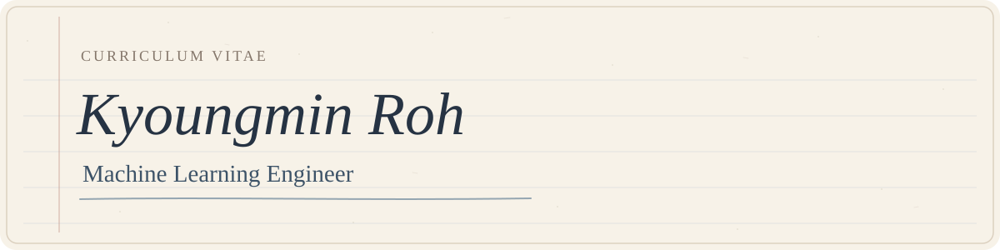

  

  
  
  
  
  

  
  
  
  
  
  
  
  
  

## Professional Summary

I am a machine learning engineer and researcher focused on decision-making models for cybersecurity, including Android malware detection under concept drift. 
My work also spans post-quantum cryptography in TEEs and confidential computing for software-defined vehicles. 
Research intern at Seoul National University, with first-author publications in CMES (SCIE Q1) and ACM SAC (BK21+ Outstanding Conference).

## Education

### Dankook University

**Bachelor of Engineering in Industrial Security** · Yongin, Republic of Korea · Mar 2021 – Expected Feb 2027

- **GPA:** 3.20/4.50 (grade percentage: 87/100)
- **Undergraduate thesis:** “Qrust: AI-Powered QR Phishing Detection and Secure QR Generation.” [Project repositories](https://github.com/dku-capstone).
- **Selected coursework:** Artificial Intelligence and Information Security, Digital Forensics, Reverse Engineering

### Wirye Hanbit High School

**High School Diploma** · Seongnam, Republic of Korea · Mar 2017 – Feb 2020

## Research Experience

### Seoul National University | [Security Optimization Research Lab](https://sor.snu.ac.kr/)

**Research Intern** · Seoul, Republic of Korea · Jun 2026 – Present  
Supervisor: Prof. Yunheung Paek; Mentor: Martin Kayondo

- Developed an **automotive virtual ECU (vECU) research platform** by resolving integration incompatibilities between Zephyr OS and Arm CCA through a custom shim layer for mixed-criticality workloads. Collaborative research since Dec 2025.
- Review mentor-assigned papers and deliver weekly presentations on **robot foundation models and vision-language-action systems**, with a current focus on **NVIDIA MIG and vGPU security**.

### Dankook University | [Computer Security and Operating Systems Lab](https://securesw.dankook.ac.kr/index.html)

**Undergraduate Research Assistant** · Yongin, Republic of Korea · Mar 2025 – Jul 2026  
Supervisor: Prof. Seong-je Cho

- Designed **SCAN** using Gaussian mixture clustering (GMM) and adaptive thresholds to address concept drift and class imbalance in Android malware detection; achieved **average accuracy and F1 scores above 91% across six years** and published the work as first author in CMES (SCIE Q1).
- Developed **API co-occurrence graph and community-based malware detection**, achieving an **F1 score above 90% over six years without retraining** and receiving the WDSC 2025 Best Paper Award. Extended the work with a mixture-of-experts model in **ALARM**, published at ACM SAC 2026 as first author.
- Implemented **split ML-KEM in OP-TEE on Arm TrustZone-A**, isolating secret-dependent operations in the Secure World and offloading public computation; reduced the **trusted code base by 90.8%** and **mean latency by 25.5%** relative to the baseline architecture. Received the Cyber Security Contest 1st Place Award and the KCC 2026 Outstanding Paper Award for the extended work.

### Indiana University Bloomington | [CPS Security Lab](https://kimhyungsub.github.io/)

**Research Intern** · Bloomington, IN, USA (Remote) · Oct 2025 – Jan 2026  
Supervisor: Assoc. Prof. Hyungsub Kim

- Built a **structured cyber-physical-system vulnerability dataset** by consolidating reports from OSV, GitHub Issues, and security forums.
- Classified reports by **affected component, failure mode, attack surface, and security impact**.

## Military Experience

### KATUSA (Korean Augmentation to the U.S. Army)

**U.S. Eighth Army, 35th Air Defense Artillery Brigade, 2-1 ADA Battalion** · Camp Carroll, Waegwan, Republic of Korea · Aug 2023 – Feb 2025  
Final rank: Sergeant (SGT)

- Received the **Army Commendation Medal (ARCOM)** and **Best KATUSA Award** for meritorious service, dependable performance, and exceptional rifle marksmanship.
- Appointed as the unit's **first KATUSA Environmental and Hazardous-Materials Safety Officer**; earned the highest examination score in the training class and established a standardized quarterly inspection protocol that eliminated historical compliance issues.
- Coordinated **supply logistics and bidirectional Korean-English interpretation** with U.S. military leadership and senior personnel; competed as a member of the winning **Best Warrior Competition squad**.
- Earned a **Certificate of Appreciation from USAG Daegu** and the **ROK Army Soldier Award** upon honorable discharge.

## Publications

*Authors are listed in order of contribution.*  
† Co-first authorship.

### International Journal Articles

1. **[SCAN: Structural Clustering with Adaptive Thresholds for Intelligent and Robust Android Malware Detection under Concept Drift](https://www.sciencedirect.com/org/science/article/pii/S1526149226001244)**  
   **Kyoungmin Roh**, Seungmin Lee, Seong-je Cho, Youngsup Hwang, and Dongjae Kim.  
   *Computer Modeling in Engineering & Sciences (CMES)*, Apr 2026.  
    

2. **Taming Concept Drift in Malware Detection via Semantic Clustering**  
   **Kyoungmin Roh**, Seong-je Cho, Kyoungwon Suh, and Hyoil Han.  
   *International Journal of Information Security*. In preparation.  

### International Conference Papers

1. **[ALARM: An Adaptive Android Malware Detection Framework with Leiden-based Clustering and Mixture-of-Experts Classification](https://dl.acm.org/doi/10.1145/3748522.3779797)**  
   **Kyoungmin Roh**, Seungmin Lee, Seong-je Cho, and Youngsup Hwang.  
   *Proceedings of the 41st ACM/SIGAPP Symposium on Applied Computing (SAC 2026)*, Thessaloniki, Greece, Mar 2026.  
    
2. **[C-STAR: Cost-Aware Adaptive Learning under Concept Drift for Android Malware Detection](https://www.scitepress.org/Link.aspx?doi=10.5220/0015073700004103)**  
   Nahee Kwon, **Kyoungmin Roh**, Youngsup Hwang, Seong-je Cho, and Boojoong Kang.  
   *Proceedings of the 23rd International Conference on Security and Cryptography (SECRYPT 2026)*, Porto, Portugal, Jul 2026.  

### Domestic Journal Articles

1. **[Concept Drift-Resilient Android Malware Detection via API Co-occurrence Graphs and Louvain Communities](https://www.dbpia.co.kr/journal/articleDetail?nodeId=NODE12586205)**  
   **Kyoungmin Roh** and Seong-je Cho.  
   *KIISE Transactions on Computing Practices (KTCP)*, Jan 2026. KCI; invited article.  
2. **Louvain Community-Based Structural Attribution of Drift Scores in Android Malware Detection**  
   Nahee Kwon, **Kyoungmin Roh**, and Seong-je Cho.  
   *Journal of KIISE (JOK)*. Accepted. KCI; invited article.  

### Domestic Conference Papers

1. **[A Lightweight ML-KEM Architecture via Secret-Dependency-Based Partitioning for Embedded TrustZone-A Systems](https://www.dbpia.co.kr/journal/articleDetail?nodeId=NODE12929715)**  
   **Kyoungmin Roh**†, Nahee Kwon†, Suhyeon Park, and Seong-je Cho.  
   *Korea Computer Congress (KCC 2026)*, Jeju, Republic of Korea, Jun 2026.  
   
2. **[SCA: A Security Descriptor-Guided Logit Calibration Module for Concept Drift Adaptation in Android Malware Detection](https://www.dbpia.co.kr/journal/articleDetail?nodeId=NODE12929707)**  
   Nahee Kwon, **Kyoungmin Roh**, Suhyeon Park, and Seong-je Cho.  
   *Korea Computer Congress (KCC 2026)*, Jeju, Republic of Korea, Jun 2026.  
   
3. **[Drift-Aware Security Module Based on Louvain Communities for Retraining-Free Android Malware Detection](https://www.dbpia.co.kr/journal/articleDetail?nodeId=NODE12577588)**  
   **Kyoungmin Roh**, Suhyeon Park, and Seong-je Cho.  
   *Korea Software Congress (KSC 2025)*, Yeosu, Republic of Korea, Dec 2025.  
   
4. **[Android Malware Detection Using Co-occurrence Graphs of APIs and Louvain Method for Community Detection](https://github.com/rohkyoungmin/Research-Papers/blob/main/WDSC/API%EB%93%A4%EC%9D%98%20%EB%8F%99%EC%8B%9C%20%EC%B6%9C%ED%98%84%20%EA%B7%B8%EB%9E%98%ED%94%84%EC%99%80%20%EC%BB%A4%EB%AE%A4%EB%8B%88%ED%8B%B0%20%ED%83%90%EC%A7%80%EC%9A%A9%20Louvain%20%EB%B0%A9%EB%B2%95%EC%9D%84%20%EC%9D%B4%EC%9A%A9%ED%95%9C%20%EC%95%88%EB%93%9C%EB%A1%9C%EC%9D%B4%EB%93%9C%20%EC%95%85%EC%84%B1%20%EC%95%B1%20%ED%83%90%EC%A7%80/WDSC2025_paper_6.pdf)**  
   **Kyoungmin Roh**, Seungmin Lee, Yudam Kim, Seokhyun Ahn, and Seong-je Cho.  
   *Workshop on Dependable and Secure Computing (WDSC 2025)*, Jeju, Republic of Korea, Aug 2025.  
   
5. **[Classifying File Fragment Types for IVI System Forensics](https://github.com/rohkyoungmin/Research-Papers/blob/main/WDSC/IVI%20%EC%8B%9C%EC%8A%A4%ED%85%9C%20%ED%8F%AC%EB%A0%8C%EC%8B%9D%EC%9D%84%20%EC%9C%84%ED%95%9C%20%ED%8C%8C%EC%9D%BC%20%ED%8C%8C%ED%8E%B8%20%EC%9C%A0%ED%98%95%20%EB%B6%84%EB%A5%98/Classifying%20File%20Fragment%20Types%20for%20IVI%20System%20Forensics.pdf)**  
   Seungmin Lee, **Kyoungmin Roh**, Jiheon Jung, Suhyeon Park, and Seong-je Cho.  
   *Workshop on Dependable and Secure Computing (WDSC 2025)*, Jeju, Republic of Korea, Aug 2025.  

### Research Competition Paper

1. **[A Lightweight Secret-Isolated Post-Quantum Cryptographic Architecture for ARM TrustZone](https://github.com/rohkyoungmin/Research-Papers/blob/main/Cyber%20Security%20Contest%202025/ARM%20TrustZone%20%EA%B8%B0%EB%B0%98%20%EA%B2%BD%EB%9F%89%20%EB%B9%84%EB%B0%80%20%EB%B6%84%EB%A6%AC%ED%98%95%20%EC%96%91%EC%9E%90%EB%82%B4%EC%84%B1%20%EC%95%94%ED%98%B8%20%EC%95%84%ED%82%A4%ED%85%8D%EC%B2%98.pdf)**  
   **Kyoungmin Roh**, Nahee Kwon, Bogyeom Kim, and Subin Jeon.  
   *Cyber Security Contest*, Department of Cybersecurity, Dankook University, Dec 2025.  
   

## Patents

*The order of inventors does not reflect their level of contribution.*

1. **Kyoungmin Roh**, Seong-je Cho, Youngsup Hwang, Seungmin Lee, Seokhyun Ahn, and Dongjae Kim. "Method and Apparatus for Robust Malicious Application Detection against Concept Drift," Korean patent, preparation reference P2026289, 2026. In preparation.
2. **Kyoungmin Roh**, Nahee Kwon, Seong-je Cho, Youngsup Hwang, and Sangwoo Ha. "Android Malware Detection System and Method Performing Cost/Stability-Aware Selective Model Update and Security-Based Output Calibration in Concept Drift Environments," Korean patent, preparation reference P2026290, 2026. In preparation.
3. **Kyoungmin Roh**, Seungmin Lee, Seong-je Cho, and Yoonho Choi. "A Malware Detection Method Combining Clustering and Supervised Learning Models," Korean Patent Application No. 10-2025-0098855, 2025. Filed.

## Projects

### Featured projects

| Project | Overview | Link |
| --- | --- | --- |
| **SCAN** | Android malware detection using structural clustering and adaptive thresholds (CMES 2026).   |  |
| **ALARM** | Android malware detection using Leiden communities and mixture of experts (ACM SAC 2026).   |  |
| **MLKEM-Split** | ML-KEM partitioning prototype with information-flow control and TEE secret isolation.   |  |
| **AISECApp** | C/C++ vulnerability analysis agents with NVD CVE mapping and deterministic evidence verification.   |  |
| **lidar_car_project** | ROS 2 robot car with web control, live LiDAR scans, and obstacle detection.   |  |

### Organization projects

| Project | Overview | Links |
| --- | --- | --- |
| **QRust** | QR phishing detection and QR-code generation service with a Flutter client, Random Forest URL classification, a Flask inference API, and a Spring Boot backend. **Role: frontend and AI.**   | [Overview](https://github.com/dku-capstone) · [AI](https://github.com/dku-capstone/QRust-AI) · [Frontend](https://github.com/dku-capstone/QRust-FE) · [Backend](https://github.com/dku-capstone/QRust-BE) |
| **Document Summarizer** | Claude-assisted PDF, TXT, and DOCX summarization with project-based summary management, JWT authentication, a React frontend, FastAPI backend, and Kubernetes deployment manifests.   | [Backend](https://github.com/DKU-OSS-development/Backend-API) · [Frontend](https://github.com/DKU-OSS-development/Frontend) · [Infrastructure](https://github.com/DKU-OSS-development/Infrastructure) · [Documentation](https://github.com/DKU-OSS-development/Documentary) |
| **LV.0 (LLM Vulnerability Zero)** | Source-code security review platform combining Semgrep static analysis, Claude-assisted vulnerability explanations, and PDF reporting through Flask services, with a React/TypeScript/Electron interface. **Role: team lead and AI/security.**   | [Overview](https://github.com/Gaurdians-of-the-Open-Source) · [Application](https://github.com/Gaurdians-of-the-Open-Source/final-result) · [Analysis services](https://github.com/Gaurdians-of-the-Open-Source/Security) |
| **Kyber-Split** | Design documentation for secret-isolated Kyber/ML-KEM on Arm TrustZone-A, with an OP-TEE client/TA communication scaffold.   | [Repository](https://github.com/Cyber-Security-Contest/Kyber-Split) · [Design](https://github.com/Cyber-Security-Contest/Kyber-Split/blob/main/documentation.md) |

<strong>More projects and tools (8)</strong>

### Research & security

| Project | Overview | Link |
| --- | --- | --- |
| **ACSAC_ARTIFACT** | Experiment code and results for semantic cluster-guided Android malware drift detection.   |  |
| **Post-Quantum-Signature-System** | Python prototype combining Lamport one-time signatures and Merkle trees.   |  |
| **api-sequence-extractor-gui** | Method-level Android API sequence extraction with Python and an Electron GUI.   |  |

### Applications

| Project | Overview | Link |
| --- | --- | --- |
| **dku_startup_hackathon** | Ttobak Ttobak: AI-assisted pronunciation training and visual feedback prototype.   |  |
| **smart-greenhouse-disease-detector** | EfficientNetB0-based crop leaf disease classification.   |  |

### Utilities

| Project | Overview | Link |
| --- | --- | --- |
| **web_crawling** | Product review collection with sentiment and emotion keyword classification.   |  |
| **image-expander** | Tkinter and Pillow GUI for adding transparent padding to PNG images.   |  |
| **ico_converter** | CLI for converting PNG and SVG images into multi-resolution ICO files.   |  |

## Honors and Awards

### Awards

| Date | Award and recognition |
| --- | --- |
| Jun 25, 2026 | **KCC 2026 Outstanding Paper Award** Korean Institute of Information Scientists and Engineers · Awarded for the paper on ML-KEM partitioning for embedded TrustZone-A |
| Dec 18, 2025 | **KSC 2025 Best Paper Award** Korean Institute of Information Scientists and Engineers · Awarded for retraining-free Android malware detection with Louvain communities |
| Dec 9, 2025 | **Cyber Security Contest, 1st Place Award** Dankook University, National Center of Excellence in Software · Won the research-paper track for split ML-KEM on TrustZone-A |
| Dec 5, 2025 | **Capstone Festival Audience Choice Award** Dankook University, National Center of Excellence in Software · Audience-selected award for the Qrust secure-QR phishing detector |
| Sep 27, 2025 | **Dankook Startup Hackathon, 3rd Place Award** Dankook University, National Center of Excellence in Software · Third place for the accessibility-focused DDobak speech-therapy prototype |
| Aug 20, 2025 | **WDSC 2025 Best Paper Award** Korean Institute of Information Scientists and Engineers · Awarded for Android malware detection using API co-occurrence graphs and Louvain communities |
| Feb 6, 2025 | **Republic of Korea Army Soldier Award** Republic of Korea Army · Awarded upon honorable discharge |
| Feb 6, 2025 | **Certificate of Appreciation** United States Army Garrison Daegu · Awarded upon honorable discharge |
| Dec 13, 2024 | **Army Commendation Medal (ARCOM)** United States Department of the Army · Recognized outstanding performance, including passing an environmental inspection and winning the Best Warrior Competition |
| Oct 17, 2024 | **Best KATUSA Award** Eighth U.S. Army ROK Army Support Group · Recognized outstanding duty performance and rifle marksmanship |
| Sep 27, 2023 | **Cipher Application Competition, 1st Place Award** Dankook University, Department of Industrial Security · First place for a post-quantum cryptographic application combining Lamport signatures and a Merkle tree |

### Honors

| Date | Scholarship and basis |
| --- | --- |
| Aug 2026 | **Danwoo Academic Merit Scholarship (KRW 1,430,000)** Dankook University · Academic performance ranking in the top 6% of the department in spring 2026 |
| Aug 2026 | **Academic Research Scholarship (KRW 1,500,000)** Dankook University, National Center of Excellence in Software · Awarded for authoring KCC 2026 research papers |
| Dec 2025 | **Academic Research Scholarship (KRW 2,000,000)** Dankook University, National Center of Excellence in Software · Awarded for authoring a KSC 2025 research paper |
| Dec 2025 | **Specialized Project Scholarship (KRW 400,000)** Dankook University, Department of Cybersecurity · Recognized extraordinary extracurricular activities within the department |
| Dec 2022 | **Specialized Project Scholarship (KRW 500,000)** Dankook University, Department of Cybersecurity · Recognized extraordinary extracurricular activities within the department |
| Aug 2022 | **Specialized Academic Merit Scholarship (KRW 287,000)** Dankook University · High academic performance in spring 2022 |
| Mar 2021 | **Admission Scholarship (KRW 1,600,000)** Dankook University, National Center of Excellence in Software · Awarded to an outstanding incoming student in the department |
| Feb 2021 | **Admission Fee Reduction Support Scholarship (KRW 182,000)** Korea Student Aid Foundation (KOSAF) · Tuition waiver scholarship |

## Additional Coursework and Training

### Chinese Native-Speaker Tutoring Program

**Dankook University, Office of International Affairs** · Sep 2025 – Dec 2025

- Completed weekly one-on-one sessions with a native Chinese instructor, strengthening speaking, listening, and cross-cultural communication through sustained conversational practice.

### LG Aimers AI Bootcamp

**LG AI Research** · Jun 2023 – Jul 2023

- Solved a smart-factory classification task after intensive coursework in machine learning, deep learning, linear algebra, and statistics. Led model training, evaluation design, and the final team presentation.

## Extracurricular Activities

### Buddhist Club | Dankook University

**Member** · Mar 2026 – Present

- Participated in prayer bead-making and Templestay events.

### AEGIS Cybersecurity Club | Dankook University

**Member** · Mar 2021 – Present

- Participate in weekly CTF exercises and technical seminars spanning cryptography, reversing, and systems security.
- Led the club's hacking team to a **top 10% finish in the CCE 2025 preliminary round** and a **top 10% finish at HacktheOn Sejong 2025**.

### OSINT Team | Remote

**Contributing Writer** · Mar 2025 – Present

- Author cybersecurity-awareness and technical articles for a global OSINT education platform, translating technical topics into practical guidance for non-specialist readers.

### Modakbul Guitar Club | Dankook University

**Member** · Mar 2022 – Feb 2026

- Practiced acoustic guitar and performed on stage in fall 2022.

### RubiyaLab CTF Team | HSPACE

**Member** · Jul 2025 – Nov 2025

- Competed in international hacking competitions, focusing on cryptography and reverse engineering, as a member of a team ranked **No. 1 in South Korea and No. 23 worldwide on CTFtime as of 2025**.

### Kendo Club | Dankook University

**Assistant Instructor & Member** · Mar 2022 – Dec 2022

- Mentored international junior members on fundamental kendo techniques and etiquette, helping them integrate into the club.

### Turing Crypto Club | Dankook University, Department of Industrial Security

**Member** · May 2022 – Dec 2022

- Studied core applied-cryptography constructions with peers and delivered seminar presentations.

## Volunteer Experience

### Rural Volunteer Service

**Volunteer** · Buyeo, Republic of Korea · Sep 2025

- Assisted with greenhouse maintenance and chestnut harvesting through a national rural-volunteering initiative, completing **21 service hours**.

## Professional Affiliations

### Korean Institute of Information Scientists and Engineers (KIISE)

**Member** · Dec 2025 – Dec 2026

- Invited to join in recognition of the **KSC 2025 Best Paper Award**.

### Korean Defense Veterans Association (KDVA)

**Member** · Aug 2025 – Present

- Made a donation in support of the Korean-American military alliance.

### KATUSA Veterans Association (KVA)

**Member** · Feb 2025 – Present

- Became a member after being discharged from KATUSA service.

## Certificates

**TOEFL iBT:** Overall **5.0/6.0 (100/120)** · R 5.5 / L 5.0 / W 5.5 / S 4.0 · CEFR C1 · ETS · Sep 16, 2026

## Languages

- **Korean:** Native
- **English:** Fluent
- **Japanese:** Conversational proficiency
- **Chinese:** Basic
- **Arabic:** Basic

---

<a href="#top">Back to top</a> &nbsp;|&nbsp; <a href="mailto:imsie1@dankook.ac.kr">Contact</a>

